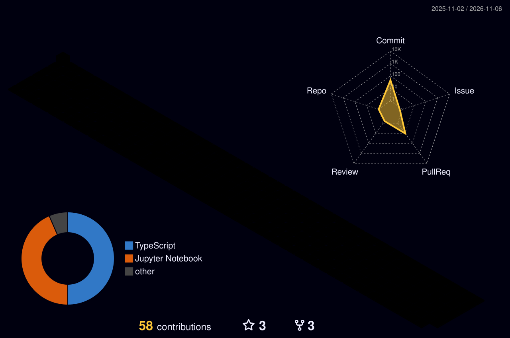

<div align="center">


<p>
  
  
  
</p>

</div>

## 🙆‍♂️ About Me

```typescript
const thanh = {
  role: "Fullstack Developer",
  education: {
    school: "Da Nang University of Science and Technology",
    major: "Data Science & Artificial Intelligence – ITF",
    status: "Graduated 🎓",
  },
  stack: {
    frontend: ["React", "Next.js", "TypeScript", "Tailwind"],
    backend: ["Node.js", "Express", "PostgreSQL", "MongoDB"],
  },
  currentFocus: ["Scalable web apps", "Clean architecture", "Great UX"],
  funFact: "I turn coffee ☕ into features — from database to pixels ✨",
};
```

- 🎓 Graduated from **Da Nang University of Science and Technology** – Data Science & AI (ITF)
- 💼 Working as a **Fullstack Developer**, shipping features from API to UI
- 🧩 Love turning ideas into clean, fast, and user-friendly products
- 🌱 Always learning, always building

## 🛠️ Tech Stack

<table align="center">
  <tr>
    <td align="center"><b>💬 Languages</b></td>
    <td></td>
  </tr>
  <tr>
    <td align="center"><b>⚛️ Front-end</b></td>
    <td></td>
  </tr>
  <tr>
    <td align="center"><b>🖥️ Back-end</b></td>
    <td></td>
  </tr>
  <tr>
    <td align="center"><b>🗄️ Database</b></td>
    <td></td>
  </tr>
  <tr>
    <td align="center"><b>🧰 Tools & DevOps</b></td>
    <td></td>
  </tr>
</table>

## 📈 GitHub Activity

<div align="center">
  
  <br/><br/>
  
  <br/><br/>
  <picture>
    <source media="(prefers-color-scheme: dark)" srcset="https://raw.githubusercontent.com/samuel7232003/samuel7232003/output/github-snake-dark.svg" />
    
  </picture>
</div>

## 📫 Let's Connect

<p align="center">
  <a href="https://www.linkedin.com/in/thanh-le-9137a224b/"></a>
  <a href="https://github.com/samuel7232003"></a>
  <a href="https://www.facebook.com/thanhchaomoinguoi/"></a>
  <a href="https://www.instagram.com/lv.thank/"></a>
</p>

<div align="center">

### ✨ Thanks for stopping by! See yaaa! 👋


</div>
